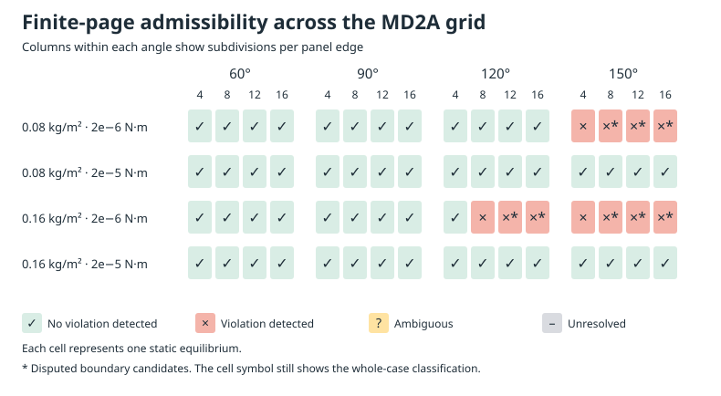

# Finite-page admissibility across the MD2A grid

Which angle and material comparisons involve a low-residual V-fold that crosses a finite page? We re-solved the committed 64-case MD2A grid without changing the static, zero-thickness model, illustrative material inputs, or solver settings. Numerical agreement requires identical named landmarks, deformation diagnostics, energy, and convergence metadata. The eight MD3 configurations also require identical solved positions and diagnostic records.

MD3 and an independent page-local calculation both check the finite page faces. The independent method projects each panel triangle into orthogonal page coordinates, slices it at the page plane, and clips the interval against the bounded face. Coplanar polygons are clipped directly. The inward roundoff margin prevents proximity from certifying overlap. Both methods exclude contact confined to intended pinned features and report boundary candidates separately. Confirmed witnesses from both methods are checked against the panel and page triangles.

## Results

| Angle | No violation detected | Violation detected | Ambiguous | Unresolved |
| ---: | ---: | ---: | ---: | ---: |
| 60° | 16 | 0 | 0 | 0 |
| 90° | 16 | 0 | 0 | 0 |
| 120° | 13 | 3 | 0 | 0 |
| 150° | 8 | 8 | 0 | 0 |

64 of 64 cases agreed on the exact confirmed page-face identities at all three tolerances and passed witness checks. Verified contacts by case: **11 of 64 transverse crossings**, 0 tangential edge contacts, and 0 coplanar overlaps. A case can contribute to more than one contact category. Confirmed unintended tangential edges and coplanar overlaps count as violations but do not enter the transverse-crossing count. Numerical convergence means the force-residual criterion was met. A clear label means the diagnostic found no violation of the tested geometry.

No whole case was ambiguous or unresolved.

Candidate sets differ for `angle-120_n-12_mass-0.16_D-0.000002`, `angle-120_n-16_mass-0.16_D-0.000002`, `angle-150_n-8_mass-0.08_D-0.000002`, `angle-150_n-12_mass-0.08_D-0.000002`, `angle-150_n-16_mass-0.08_D-0.000002`, `angle-150_n-8_mass-0.16_D-0.000002`, `angle-150_n-12_mass-0.16_D-0.000002`, `angle-150_n-16_mass-0.16_D-0.000002`. The independent search clips the convex hull of near-plane vertices and plane-slice points, while MD3 also checks edges in both directions. The JSON retains the disputed face IDs and tolerances. These candidates do not enter any confirmed-contact count.

## Refinement and material comparisons

| Comparison | Both clear | Includes detected violation | Ambiguous or unresolved | Total |
| --- | ---: | ---: | ---: | ---: |
| Refinement | 39 | 9 | 0 | 48 |
| Mass | 25 | 7 | 0 | 32 |
| Stiffness | 21 | 11 | 0 | 32 |

Each comparison retains both endpoint labels. The JSON also retains the 48 original refinement metrics and the signed change in RMS deformation and maximum matched free-landmark shift for material contrasts with resolved endpoints. A comparison involving a detected violation still describes the unconstrained numerical solution. It has weaker evidence for an admissible geometry.

On the finest mesh, the numbers of material contrasts with two clear endpoints are:

| Angle | Mass contrasts with clear endpoints | Stiffness contrasts with clear endpoints |
| ---: | ---: | ---: |
| 60° | 2 / 2 | 2 / 2 |
| 90° | 2 / 2 | 2 / 2 |
| 120° | 1 / 2 | 1 / 2 |
| 150° | 1 / 2 | 0 / 2 |

### Mass contrasts on the finest mesh

| Angle | Stiff: RMS change (mm) | Stiff endpoints | Soft: RMS change (mm) | Soft endpoints |
| ---: | ---: | --- | ---: | --- |
| 60° | 0.087 | no violation detected → no violation detected | 1.765 | no violation detected → no violation detected |
| 90° | 0.158 | no violation detected → no violation detected | 3.831 | no violation detected → no violation detected |
| 120° | 0.274 | no violation detected → no violation detected | 19.467 | no violation detected → transverse crossing |
| 150° | 0.604 | no violation detected → no violation detected | 0.123 | transverse crossing → transverse crossing |

The signed change is heavier minus lighter. A dash marks a contrast withheld because an endpoint is missing or unresolved.

### Fine-mesh checks for soft material at large angles

| Angle | Mass (kg/m²) | Maximum 12→16 landmark shift (mm) | Endpoints |
| ---: | ---: | ---: | --- |
| 120° | 0.08 | 0.139 | no violation detected → no violation detected |
| 120° | 0.16 | 0.015 | transverse crossing → transverse crossing |
| 150° | 0.08 | 0.008 | transverse crossing → transverse crossing |
| 150° | 0.16 | 0.019 | transverse crossing → transverse crossing |

At least one fine-mesh pair has a maximum sampled landmark shift below 0.02 mm with verified transverse crossings at both endpoints. Refinement agreement and a small force residual can therefore coexist with geometric invalidity. This analysis leaves the cause of the mesh-dependent equilibrium change open.

Pair counts depend on tessellation and do not measure penetration severity. The check covers finite nominal page surfaces, with neither thickness nor contact response. Panel self-contact checks come from MD3 and are outside the independent page verifier. Static equilibria with uncalibrated material inputs cannot establish physical accuracy, continuum convergence, or unfolding dynamics.

Run `node experiments/admissibility-grid.mjs` to regenerate the [full data](admissibility-grid.json), this report, and the figure.
