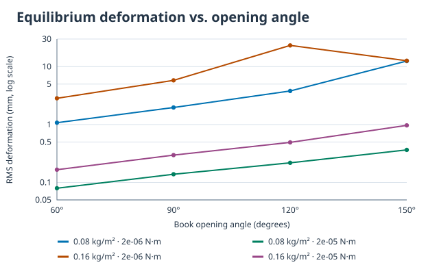
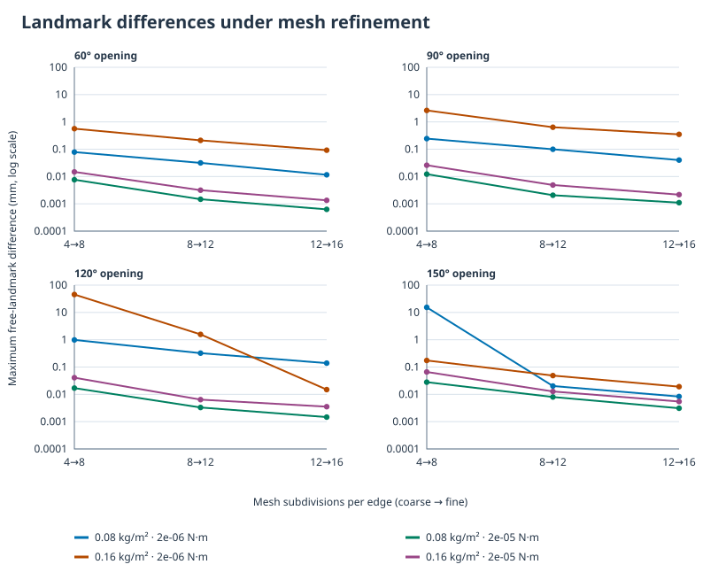

# Material sensitivity across V-fold opening angles

How do paper mass and bending stiffness influence equilibrium deformation as the V-fold opens, and which observations remain stable under mesh refinement?

## Setup

The 64-run factorial combines 60°, 90°, 120°, and 150° openings with mesh subdivisions of 4, 8, 12, and 16 per panel edge, mass per area of 0.08 and 0.16 kg/m², and bending stiffness of 2e−6 and 2e−5 N·m. The symmetric baseline geometry and the attachment locations on the pages stay fixed across material and mesh settings. Every solve starts from its same-angle rigid reference with gravity (0, 0, −9.81) m/s², stretching modulus 100 N/m, and Poisson ratio 0.3. Material values are illustrative.

The static solver minimizes membrane, bending, and gravitational energy with pinned attachment edges. A case meets the solver criterion when the maximum area-normalized free-vertex force is at most 0.005 N/m². The iteration cap is 6,000. The eight fine-mesh pilot cases at 90° and 150° tested light/stiff and heavy/soft combinations. All eight passed with finite measurements and zero attachment displacement. All 64 cases subsequently met the same residual criterion, and all 48 adjacent-mesh comparisons were available. The pilot cases are included in the 64.

Run `node experiments/angle-convergence.mjs` to regenerate the [JSON](angle-convergence.json) and [per-case CSV](angle-convergence.csv). Use `--pilot` to write a separate pilot result. The JSON lists pilot IDs, all named landmark coordinates, solver metadata, and pairwise differences in millimetres.

## Material effects

Area-weighted RMS deformation at n = 16 relative to each angle's rigid reference, in millimetres.

| Angle | Light, soft | Light, stiff | Heavy, soft | Heavy, stiff |
|---:|---:|---:|---:|---:|
| 60° | 1.0772 | 0.0796 | 2.8423 | 0.1663 |
| 90° | 1.9714 | 0.1387 | 5.8021 | 0.2969 |
| 120° | 3.8027 | 0.2185 | 23.2697 | 0.4924 |
| 150° | 12.5223 | 0.3653 | 12.6449 | 0.9688 |

At the stiffer setting, doubling mass increased RMS deformation at all four angles. The increase grew from 0.087 mm at 60° to 0.604 mm at 150°. In the soft cases, the mass effect peaked at 120° and narrowed sharply at 150°. Raising stiffness lowered deformation at every angle and at both masses. The heavy, soft RMS peak at 120° is sensitive to the coarse mesh and warrants inspection of the equilibrium shape.

For each matched mass or stiffness contrast, the table gives the maximum difference in the five free landmark positions at n = 16, followed by the sum of both configurations' maximum 12→16 shifts. Values are in millimetres. The sum is a comparison scale for the observed mesh changes.

| Angle | Mass, soft | Mass, stiff | Stiffness, light | Stiffness, heavy |
|---:|---:|---:|---:|---:|
| 60° | 3.570 / 0.104 | 0.201 / 0.002 | 2.232 / 0.012 | 5.585 / 0.093 |
| 90° | 7.064 / 0.390 | 0.364 / 0.003 | 3.917 / 0.041 | 10.539 / 0.352 |
| 120° | 50.158 / 0.154 | 0.617 / 0.005 | 7.019 / 0.141 | 54.141 / 0.018 |
| 150° | 0.327 / 0.027 | 1.253 / 0.009 | 28.778 / 0.011 | 28.180 / 0.025 |

All 16 fine-mesh contrasts exceed that comparison scale. This supports resolving the contrasts at the sampled landmarks on the tested fine meshes. It does not bound their continuum errors.

## Mesh refinement

Each pair compares the deformed 3D positions of the same barycentric material landmarks. The RMS and maximum use five free landmarks. The three pinned landmarks are reported separately. All 16 groups showed decreasing **maximum** landmark differences over the three successive pairs. A decrease does not establish a convergence rate or whole-surface convergence.

The heavy, soft 120° group had maximum shifts of **45.333, 1.571, and 0.015 mm** for 4→8, 8→12, and 12→16. The light, soft 150° group dropped from **15.344 mm** at 4→8 to **0.008 mm** at 12→16. The heavy, soft 90° group retained the largest fine-pair change at **0.350 mm**. The abrupt coarse changes are consistent with strong discretization sensitivity or a change of local equilibrium. The sweep does not distinguish those explanations.

These are independent fixed-angle equilibria from one initialization. The model omits contact, self-collision, and crease elasticity. A low residual certifies the solver's force criterion only. Fine-pair agreement does not validate shapes against real paper, rule out intersections, or predict opening dynamics or hysteresis.
