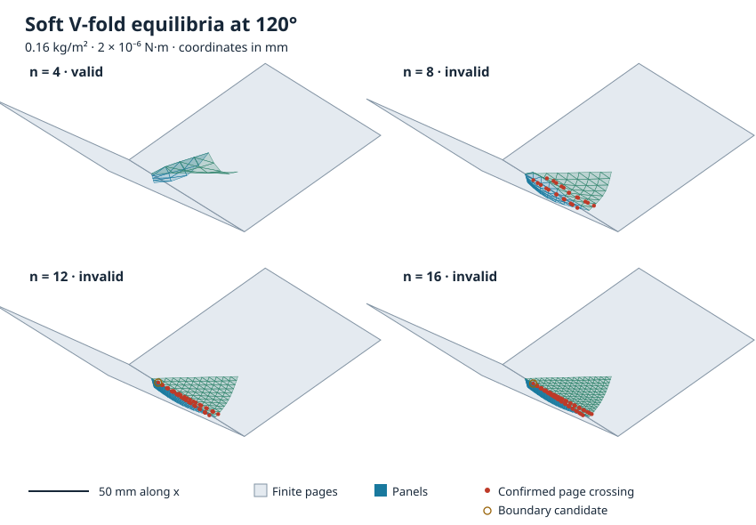

# Geometric validity at a 120° V-fold opening

Can a flexible V-fold solution satisfy the force-residual criterion and still cross a book page? We re-solved eight MD2A cases at 120° with mass per area 0.16 kg/m², bending stiffness 2e−6 or 2e−5 N·m, and 4, 8, 12, or 16 subdivisions per panel edge. The baseline geometry, raised rigid initialization, pinned attachments, gravity (0, 0, −9.81) m/s², stretching modulus 100 N/m, Poisson ratio 0.3, and solver settings match MD2A. The material values are illustrative.

## Method

The diagnostic checks the solved triangle surfaces without changing their positions. Bounding boxes reject separated pairs. Edge–plane intersections and in-triangle tests detect noncoplanar contact. Coplanar edges are clipped against the target triangle's inward half-planes. The diagnostic checks within-panel pairs, between-panel pairs, and panel triangles against the two triangles of each finite book page. Shared vertices, mesh edges, the welded ridge, and the pinned attachment features are allowed only within their feature neighborhoods.

For a transverse panel–page intersection, the panel's plane slice must retain positive length inside the finite face inset by a floating-point allowance of 64 machine epsilons times the reference coordinate extent (approximately 2.1e−15 m here). This margin keeps overlap within the roundoff band from establishing confirmation. Saved endpoints come from clipping to the original face. An in-plane edge uses the same positive-length criterion. Coplanar triangles require zero plane distances in the calculation and a point inside both faces by more than the allowance. The shared-feature rule still applies. A contact supported only by proximity, the roundoff band, or a single tangential point is recorded as a boundary candidate, even if it appears at all three tolerances.

On this geometry the baseline distance tolerance is 1e−8 m, or 1e−7 times the reference ridge length. It governs the tolerance-expanded search and contact-coordinate deduplication. The shared-feature allowance is four times that distance. The intersection scan repeats at 0.1× and 10×. Changes to the confirmed contact sets mark the classification as ambiguous unless a separate invariant fails. Changes to either set are recorded as tolerance sensitivity. A boundary candidate alone also leaves the result ambiguous. A confirmed crossing can still establish invalidity when a separate boundary candidate remains unresolved. Attachment drift above 1e−11 m and triangle area at or below 1e−6 times its reference area are invalid. Nonfinite geometry, a failed solve, or disagreement with MD2A beyond a landmark allowance of 1e−8 m prevents interpretation.

## Results

Every solve satisfied the 0.005 N/m² criterion, matched the saved MD2A landmarks exactly, and preserved all pinned coordinates. There were no degenerate triangles or flagged within-panel or between-panel contacts.

| Bending stiffness (N·m) | Mesh n | Residual (N/m²) | Iterations | Min. area / reference | Confirmed face pairs | Boundary candidates | Status |
|---:|---:|---:|---:|---:|---:|---:|---|
| 2e−6 | 4 | 0.004463 | 334 | 0.995309 | 0 | 0 | Valid |
| 2e−6 | 8 | 0.004645 | 1344 | 0.944529 | 24 | 0 | Invalid |
| 2e−6 | 12 | 0.004734 | 1723 | 0.999826 | 43 | 1 | Invalid |
| 2e−6 | 16 | 0.004950 | 1879 | 0.999828 | 55 | 1 | Invalid |
| 2e−5 | 4 | 0.003861 | 132 | 0.999141 | 0 | 0 | Valid |
| 2e−5 | 8 | 0.004406 | 285 | 0.998855 | 0 | 0 | Valid |
| 2e−5 | 12 | 0.003460 | 578 | 0.998715 | 0 | 0 | Valid |
| 2e−5 | 16 | 0.004844 | 1054 | 0.998626 | 0 | 0 | Valid |

Pair counts refer to intersections between a panel triangle and a page triangle. The count depends on tessellation and does not measure penetration depth or independent collision events. All confirmed pairs were noncoplanar. Their panel triangles had vertices on both sides of the associated page plane, with signed height magnitudes exceeding 1e−7 m on both sides. Confirmed pair identities and candidate identities stayed the same at all three tolerances. The two candidates are panel/page/face IDs [23, 1, 1] at n = 12 and [316, 0, 1] at n = 16. Their plane slices miss the finite spine edge by about 1.36e−10 m and 5.18e−12 m respectively. They are excluded from confirmed counts. Both configurations have other confirmed crossings, so their overall status remains invalid. No whole case was ambiguous or unresolved.

## Interpretation

The 45.333 mm maximum landmark shift from n = 4 to n = 8 separates a soft case with no detected unintended intersection from one that crosses a page. The n = 12 and n = 16 soft configurations agree closely at the sampled landmarks, and both cross the pages. Their fine-mesh agreement is therefore insufficient to support an admissible physical shape. The stiffer controls had no detected crossings at any tested resolution. This establishes a stiffness and resolution difference within these eight static solves. It leaves open whether the unconstrained solver reaches different local equilibria, and how the shapes would change with contact constraints or measured material properties.

The diagnostic uses zero-thickness surfaces and floating-point predicates. The tolerances bound the geometric classification procedure and do not represent a physical clearance. Valid means no violation was detected by these checks. It does not certify whole-surface convergence, global optimality, dynamics, or physical accuracy.

Run `node experiments/geometry-validity.mjs` to reproduce the [JSON results](geometry-validity.json). It records positions and contact coordinates in metres, energy-model parameters in SI units, angle in degrees, and one contact list per tolerance. The SVG is a static oblique projection of the saved page and panel geometry and recorded baseline confirmed contacts and separate boundary candidates.
